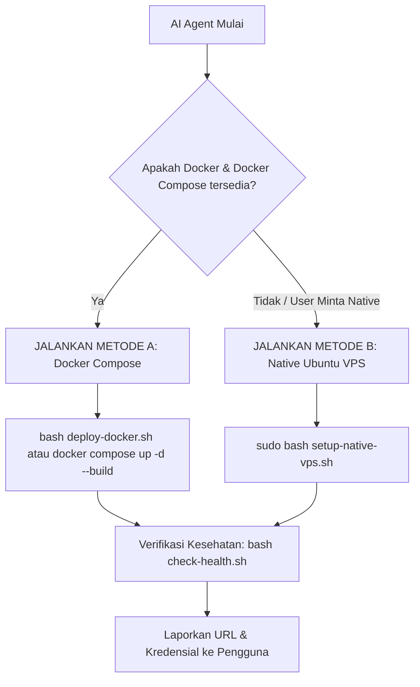

# AI AGENT INSTRUCTION & DEPLOYMENT RUNBOOK
## Arunika F&B POS Suite (Production Deployment on Linux VPS)

Dokumen ini adalah instruksi operasional untuk AI Agent (seperti Antigravity, Claude Code, Cursor, Codex, dll.) yang berjalan di VPS ini untuk segera meluncurkan seluruh layanan website Arunika POS Suite secara otonom dan andal.

---

## 1. Ringkasan Arsitektur Proyek
Repository ini terdiri dari 4 komponen:
1. **`pos-backend`** (PHP 8.3 / Laravel 11): REST API, Autentikasi Sanctum, SSE (`/api/orders/stream`), Database SQLite WAL mode. (Port 8000 / PHP-FPM).
2. **`forecasting-engine`** (Python 3.11 / FastAPI): AI Demand & Stock Forecasting microservice. (Port 8001).
3. **`pos-frontend`** (React 18 + Vite + Tailwind 4 + Framer Motion): Web app kasir, manajemen meja, admin dashboard, KDS. (Port 5173 / Nginx root `/`).
4. **`cafe-frontend`** (React 18 + Vite + Tailwind 4 + Framer Motion): Portal self-order tamu kafe via QR code meja. (Port 5174 / Nginx `/menu`).

---

## 2. Fast-Track Deployment (Tindakan Cepat AI Agent)

Jika Anda diminta untuk **"Jalankan website sekarang di VPS"**, ikuti alur pengambilan keputusan berikut:



---

### METODE A: Menggunakan Docker Compose (Paling Cepat & Terisolasi)
Gunakan metode ini jika `docker` sudah terpasang di VPS:

1. **Jalankan skrip otomatis:**
   ```bash
   chmod +x deploy-docker.sh check-health.sh
   ./deploy-docker.sh
   ```
   *Atau jalankan manual:*
   ```bash
   docker compose up -d --build
   sleep 15
   ./check-health.sh
   ```
2. **Akses Layanan:**
   - POS Kasir & Admin: `http://<IP_VPS>:5173`
   - Portal Tamu Kafe: `http://<IP_VPS>:5174`
   - Backend API: `http://<IP_VPS>:8000/api`
   - AI Forecasting Engine: `http://<IP_VPS>:8001/docs`

---

### METODE B: Native Ubuntu Systemd & Nginx (Ultra-Lightweight & Hemat RAM < 200MB)
Gunakan metode ini pada VPS spek rendah (1 vCPU, 1 GB RAM):

1. **Jalankan skrip installer otomatis:**
   ```bash
   chmod +x setup-native-vps.sh check-health.sh
   sudo ./setup-native-vps.sh
   ```
2. **Skrip akan otomatis melakukan:**
   - Pembuatan Swap 2GB (mencegah Crash OOM saat build frontend).
   - Instalasi PHP 8.3-FPM, SQLite, Python3 venv, Node 20, dan Nginx.
   - Migrasi dan seeding database SQLite (`pos-backend/database/database.sqlite`).
   - Pembuatan systemd daemon `arunika-forecasting.service` di port 8001.
   - Build frontend `pos-frontend` dan `cafe-frontend`.
   - Setup konfigurasi reverse-proxy Nginx dengan dukungan Server-Sent Events (SSE) non-buffering.
   - Pendaftaran cron job harian Laravel.
3. **Akses Layanan:**
   - POS Kasir & Admin: `http://<IP_VPS>/`
   - Portal Tamu Kafe: `http://<IP_VPS>/menu`
   - Backend API: `http://<IP_VPS>/api`

---

## 3. Akun Default Login (Hasil Database Seeder)
Untuk pengujian atau login pertama kali:

| Peran (Role) | Email | Password | Hak Akses |
| :--- | :--- | :--- | :--- |
| **Owner / Superadmin** | `owner@pos.com` | `password` | Akses penuh seluruh modul & laporan |
| **Admin Toko** | `admin@pos.com` | `password` | Pengaturan menu, stok, karyawan |
| **Kasir (Cashier 1)** | `kasir@pos.com` | `password` | Transaksi POS kasir & billing |
| **Kasir (Cashier 2)** | `kasir2@pos.com` | `password` | Shift kasir kedua |
| **Dapur (Kitchen)** | `kitchen@pos.com` | `password` | Kitchen Display System (KDS) |

---

## 4. Perintah Diagnostik & Verifikasi Kesehatan (Health Check)

Untuk memverifikasi apakah seluruh layanan aktif tanpa membuka browser:
```bash
./check-health.sh
```

Atau cek satu per satu:
```bash
# 1. Cek Forecasting Engine
curl -i http://127.0.0.1:8001/health

# 2. Cek Laravel Backend Core
curl -i http://127.0.0.1:8000/api/health

# 3. Cek Status Systemd Service (Jika Native)
sudo systemctl status arunika-forecasting
sudo systemctl status php8.3-fpm
sudo systemctl status nginx
```

---

## 5. Panduan Troubleshooting Khusus AI Agent

1. **Eror `framer-motion` tidak ditemukan saat build:**
   - Solusi: Pastikan `npm install` sudah dijalankan di masing-masing direktori `pos-frontend` dan `cafe-frontend`.
2. **Proses `npm run build` mati tiba-tiba (*Killed*) di VPS 1GB RAM:**
   - Penyebab: Out of Memory (OOM).
   - Solusi: Pastikan Swap 2GB sudah aktif (`swapon --show`). Jika belum, aktifkan dengan:
     ```bash
     sudo fallocate -l 2G /swapfile && sudo chmod 600 /swapfile && sudo mkswap /swapfile && sudo swapon /swapfile
     ```
3. **Database SQLite Permission Denied (`readonly database`):**
   - Solusi: Berikan kepemilikan direktori `database` dan file `database.sqlite` kepada `www-data`:
     ```bash
     sudo chown -R www-data:www-data pos-backend/database pos-backend/storage
     sudo chmod -R 775 pos-backend/database pos-backend/storage
     ```
4. **Order Real-time KDS tidak update instan (SSE macet):**
   - Penyebab: Nginx melakukan buffer terhadap koneksi `/api/orders/stream`.
   - Solusi: Pastikan di Nginx block lokasi `/api/orders/stream` terdapat `fastcgi_buffering off;` dan `proxy_buffering off;`.
