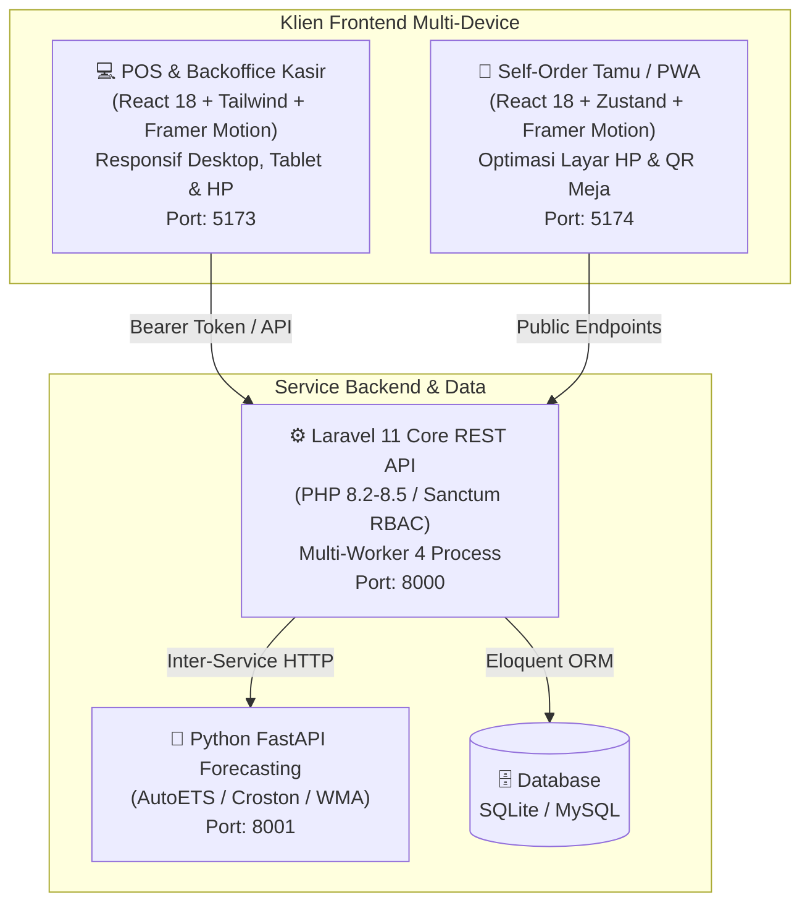
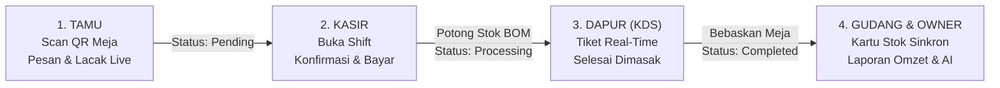

# ☕ Sistem Kasir & ERP Mini F&B — Arunika POS Suite

[](https://laravel.com)
[](https://php.net)
[](https://react.dev)
[](https://www.framer.com/motion/)
[](https://fastapi.tiangolo.com)
[](https://docker.com)
[](#-pengujian-otomatis-automated-tests)

Ekosistem **Point of Sale (POS)** dan **Enterprise Resource Planning (ERP) Mini** berbasis web modern yang dirancang khusus untuk operasional industri _Food & Beverage_ (F&B) seperti kafe, kedai kopi, warmindo, dan restoran.

Sistem ini dikembangkan dengan fokus pada **Integritas Finansial**, **Pencegahan Kecurangan (Fraud Prevention)**, **Keamanan Web Multi-Lapis**, **Pelacakan Resep & Bahan Baku Otomatis (Bill of Materials / BOM)**, **Microservice Peramalan Kebutuhan Stok (Smart Inventory Forecasting)** berbasis statistik time-series adaptif, serta **Pengalaman Pengguna (UI/UX) Responsif Multi-Rasio Layar HP & Animasi Berstandar Industri (Framer Motion)**.

---

## 🎯 Nilai Inovasi & Keunggulan Kompetisi

1. **Anti-Leakage & Real-Time BOM Deduction**:
   Penjualan menu otomatis memotong takaran bahan baku mentah (misal: 1 porsi Indomie Goreng memotong mie dan minyak goreng) secara atomik dalam transaksi database ACID tepat saat kasir mengonfirmasi pesanan.
2. **Audit Trail Mutasi Stok Menyeluruh**:
   Setiap perubahan stok (penjualan, penerimaan barang supplier, penyesuaian opname, void kasir, hingga limbah dapur) mencatat jejak audit komprehensif (_who, when, delta, reason_).
3. **Pemberlakuan Buka Shift Kasir (*Shift Enforcement*)**:
   Kasir wajib membuka shift dan menginput modal awal laci (*starting cash drawer*) sebelum memproses transaksi `Bayar (F8)`. Menjamin uang fisik dan setoran akhir shift **100% klop tanpa selisih kasir**.
4. **Keamanan Otorisasi VOID (*Cashier Fraud Prevention*)**:
   Pembatalan transaksi lunas (`paid`, `processing`, atau `completed`) secara ketat dibatasi hanya untuk wewenang **Supervisor, Admin, atau Superadmin**. Mencegah kecurangan kasir membatalkan transaksi sepihak dan menggelapkan uang tunai.
5. **Pembatalan Mandiri Pelanggan (*Guest Self-Cancel*)**:
   Tamu di meja yang memesan via QR HP dapat membatalkan pesanan secara mandiri di layar pelacakan (`TrackPage`) selama pesanan masih berstatus `pending` (belum diverifikasi kasir).
6. **Proteksi Presisi Matematika Float IEEE 754**:
   Kalkulasi kembalian tunai dilindungi dari *floating-point error*, menjamin uang pas tidak pernah memicu error palsu *"Uang kurang"*, serta kembalian tidak pernah negatif.
7. **Kalkulasi HPP Dinamis & Food Cost Ratio**:
   Model produk dilengkapi perhitungan HPP otomatis dari resep BOM dan rasio *Food Cost Percentage* untuk memastikan margin kotor kafe berada di rentang standar industri F&B yang sehat (**28% – 35%**).
8. **Deteksi Anomali Rekonsiliasi (Stock Opname)**:
   Sistem membandingkan hitungan fisik dengan stok ekspektasi sistem. Selisih di atas 5% otomatis ditandai sebagai **indikasi anomali kecurangan**.
9. **Smart Multi-Tier Forecasting Microservice**:
   Peramalan kebutuhan bahan baku dengan routing otomatis:
   - **Tier 1 (AutoETS)**: Fast-moving items dengan P90 Prediction Interval.
   - **Tier 2 (Croston's Method)**: Permintaan terputus (_intermittent/lumpy demand_).
   - **Tier 3 (Weighted Moving Average)**: Cold-start bahan baku baru.
   - Evaluasi akurasi mandiri (_Self-Evaluating WAPE Metric_) dan rekomendasi kuantitas belanja dalam satuan kemasan (karton/botol/pack).
10. **Modern UI/UX Animation & Micro-Interactions (Framer Motion)**:
    Animasi fisika pegas natural (*spring physics*) di seluruh aplikasi kasir dan portal tamu: transisi rute halus (`AnimatePresence`), tiket dapur KDS dengan audio chime, drawer keranjang geser, serta modal pop dengan *backdrop blur*.
11. **Multi-Worker Server & Non-Blocking Real-Time SSE**:
    Server backend berjalan dalam mode **Multi-Worker (4 proses paralel)** dengan Server-Sent Events non-blocking instan (< 20 ms), bebas dari kendala antrean worker blocking.
12. **Master Excel Consolidation (All-in-One Multi-Sheet Workbook)**:
    Ekspor satu klik untuk Owner yang menggabungkan seluruh 9 modul laporan (Omzet, HPP, Margin Laba Kotor, Menu Terlaris, Performa Kasir, Limbah Dapur, Rekonsiliasi Opname, Prediksi Stok AI, dan Detail Transaksi) ke dalam **satu file spreadsheet multi-sheet terpadu** (.xls) berstandar akuntansi.

---

## 🏛️ Arsitektur Sistem



---

## 🔄 Alur Kerja End-to-End (4 Aktor)



---

## 🔑 Akun Demo Pengujian (Seeded Credentials)

Seluruh password akun demo adalah: **`password`**

| Peran (Role) | Email | Nama Pengguna | Akses & Wewenang |
| :--- | :--- | :--- | :--- |
| **Owner / Superadmin** | `owner@pos.com` | Pak Budi Santoso | Akses Penuh, Audit Mutasi, Rekonsiliasi Anomali, Executive Forecast, Hak VOID |
| **Admin Manager** | `admin@pos.com` | Andi Prasetyo | Master Katalog Menu, Resep Bahan (BOM), Meja, Input Waste Dapur, Hak VOID |
| **Kasir Utama** | `kasir@pos.com` | Rina Wulandari | Transaksi POS, Buka/Tutup Shift Kasir, Cetak Struk, Hold/Resume, Konfirmasi QR |
| **Kasir 2** | `kasir2@pos.com` | Dedi Kurniawan | Operasional POS Kasir cadangan |
| **Dapur (Kitchen)** | `kitchen@pos.com` | Mas Agus | Kitchen Display System (KDS), Selesai Saji Pesanan |

---

## 🚀 Panduan Menjalankan Sistem

### Cara 1: Launcher Sekali Klik di Windows (Paling Praktis)

Cukup klik ganda file berikut pada root direktori:

- **`run-all.bat`** (Batch Script Launcher) — Otomatis membuka 4 jendela terminal dengan multi-worker backend aktif dan binding IP `0.0.0.0` (dapat diakses smartphone via Wi-Fi lokal).
- Atau jalankan melalui PowerShell:
  ```powershell
  .\run-all.ps1
  ```
- Untuk mematikan seluruh layanan:
  ```powershell
  .\stop-all.ps1
  ```

---

### Cara 2: Menggunakan Docker Compose (Satu Perintah)

Prasyarat: Docker Desktop / Docker Engine.

```bash
docker compose up --build -d
```

Seluruh 4 kontainer akan otomatis dibangun dan berjalan dengan isolated network:

- **POS & Admin Backoffice**: `http://localhost:5173`
- **Cafe Guest Self-Order**: `http://localhost:5174`
- **Backend Core REST API**: `http://localhost:8000`
- **AI Forecasting Engine Docs**: `http://localhost:8001/docs`

---

### Cara 3: Menjalankan Manual per Layanan (Development Mode)

#### 1. Backend REST API (`pos-backend`)
```bash
cd pos-backend
composer install
cp .env.example .env
php artisan key:generate
php artisan migrate --seed
$env:PHP_CLI_SERVER_WORKERS=4 ; php artisan serve --host=0.0.0.0 --port=8000 --no-reload
```

#### 2. AI Forecasting Microservice (`forecasting-engine`)
```bash
cd forecasting-engine
pip install -r requirements.txt
python run.py
```

#### 3. Backoffice & POS Kasir (`pos-frontend`)
```bash
cd pos-frontend
npm install
npm run dev -- --host 0.0.0.0 --port 5173
```

#### 4. Guest Self-Order Portal (`cafe-frontend`)
```bash
cd cafe-frontend
npm install
npm run dev -- --host 0.0.0.0 --port 5174
```

> [!TIP]
> Dengan menyertakan flag `--host 0.0.0.0`, Anda dapat langsung mengakses aplikasi kasir dan katalog menu tamu dari **browser handphone atau tablet** yang terhubung pada jaringan Wi-Fi lokal yang sama.

---

## 🧪 Pengujian Otomatis (Automated Tests)

Semua komponen dilengkapi test suite otomatis dan lulus pengujian 100%:

```bash
# 1. Jalankan Unit & Feature Test Backend Laravel (59 Test Cases, 253 Assertions)
cd pos-backend && php artisan test

# 2. Jalankan Test Microservice AI Forecasting
cd forecasting-engine && python test_engine.py

# 3. Validasi Build Produksi Frontends
cd pos-frontend && npm run build
cd ../cafe-frontend && npm run build
```

Hasil verifikasi:
- **Backend Test Suite**: `59 passed, 253 assertions (100% Green)`
- **Forecasting Suite**: `All Python forecasting tests passed successfully`
- **Frontend Bundling**: `0 errors, Vite production bundle valid (pos-frontend & cafe-frontend)`

---

## 🛡️ Fitur Keamanan & Pemeliharaan Terjadwal

- **Anti-Fraud VOID Protection**: Hanya peran `admin` dan `superadmin` yang diizinkan membatalkan transaksi yang sudah lunas/diproses.
- **Shift Guard**: Memblokir transaksi checkout jika kasir belum membuka shift dengan modal awal.
- **IDOR Defense on Public Orders**: Pelacakan pesanan publik tamu memakai nomor nota unguessable (`ARN-XXXXXXXX`) serta pembatasan akses data order historis.
- **RBAC & Privilege Escalation Guard**: Proteksi akun Superadmin (Owner) agar tidak dapat diubah password-nya atau dihapus oleh role Admin biasa.
- **Financial Statement Isolation**: Laporan laba kotor, HPP resep, dan ekspor spreadsheet master diisolasi khusus untuk role manajerial via `EnsureAdmin`.
- **Anti-Stored XSS Image Upload**: Filter berkas foto produk membatasi hanya pada format raster murni (`jpeg,png,jpg,webp,gif`).
- **Brute Force Defense**: Rate limiting adaptif (`throttle:6,1`) pada endpoint autentikasi `/api/login` dan (`throttle:30,1`) pada pemesanan publik.
- **System Health Monitor**: Endpoint `/api/health` memverifikasi kesiapan database dan ketersediaan microservice AI secara real-time.
- **Sanctum Expiration**: Masa aktif token dibatasi maksimal 24 jam untuk memitigasi risiko pembajakan sesi.
- **Mass Assignment Safe**: 100% model Eloquent menggunakan proteksi `$fillable` eksplisit.

---

## 📂 Struktur Repositori

```
Sistem-kasir-arunika/
├── cafe-frontend/                 # Aplikasi Pemesanan Mandiri Tamu (React 18 + PWA + Framer Motion)
│   ├── src/pages/                 # QR Entry Meja, Menu, Keranjang, Pelacakan Live, Riwayat
│   ├── src/store/                 # Zustand Stores (Cart, Order History, Settings)
│   └── src/api/                   # API Client & Data Mapper
├── forecasting-engine/            # Microservice Peramalan Stok (Python FastAPI)
│   ├── main.py                    # Multi-Tier Routing (AutoETS, Croston, WMA)
│   ├── test_engine.py             # Math Formula Unit Tests
│   └── run.py                     # Uvicorn Server Launcher
├── pos-backend/                   # REST API Core Engine (Laravel 11, PHP 8.2+)
│   ├── app/Models/                # 13 Model Eloquent ($fillable eksplisit & booted hooks)
│   ├── app/Services/              # Service Layer (Pricing, Inventory, Reconcile, Forecast, Reports)
│   ├── app/Http/Controllers/      # 21 REST API Controllers
│   ├── app/Http/Middleware/       # EnsureAdmin & EnsureSuperAdmin RBAC Guards
│   ├── routes/api.php             # Throttled, Protected, & Sanitized API Routes
│   └── tests/                     # 59 Unit & Feature Test Cases (253 assertions)
├── pos-frontend/                  # Backoffice & POS Kasir (React 18 + Tailwind + Framer Motion)
│   ├── src/pages/pos/             # POS Terminal, Katalog, Cart Drawer, Banner Pesanan Tamu
│   ├── src/pages/kitchen/         # Kitchen Display System (KDS) Live Tickets & SLA Timers
│   ├── src/pages/orders/          # Riwayat Transaksi & Filter Void
│   ├── src/pages/admin/           # Master Bahan, Resep BOM, Meja, Limbah, Forecasting AI, Laporan
│   └── src/pages/superadmin/      # Rekonsiliasi Opname & Audit Log
├── docker-compose.yml             # Orkestrasi Seluruh Layanan
├── run-all.bat & run-all.ps1      # Launcher Sekali Klik Windows (Multi-Worker 4 Process)
├── stop-all.bat & stop-all.ps1    # Stopper Seluruh Layanan
├── VPS_DEPLOYMENT_GUIDE.md        # Panduan Deployment Cloud / VPS Production
└── README.md                      # Dokumentasi Utama Repository
```

---

## 📖 Dokumentasi Lanjutan

- [**Laporan Audit Bug & Master Ledger Lengkap (`Laporan-Audit-Bug-dan-Workflow-Arunika.md`)**](Laporan-Audit-Bug-dan-Workflow-Arunika.md) — Rekapitulasi histori 18+ bug, akar masalah teknis, dan perbaikan end-to-end.
- [**Dokumentasi Alur Kerja End-to-End (`Workflow-Arunika-End-to-End.md`)**](Workflow-Arunika-End-to-End.md) — Alur detail Tamu $\rightarrow$ Kasir $\rightarrow$ Dapur $\rightarrow$ Gudang $\rightarrow$ Owner.
- [**Panduan Deployment VPS (`VPS_DEPLOYMENT_GUIDE.md`)**](VPS_DEPLOYMENT_GUIDE.md) — Setup Nginx reverse proxy, SSL Certbot, Supervisor, dan systemd service.
