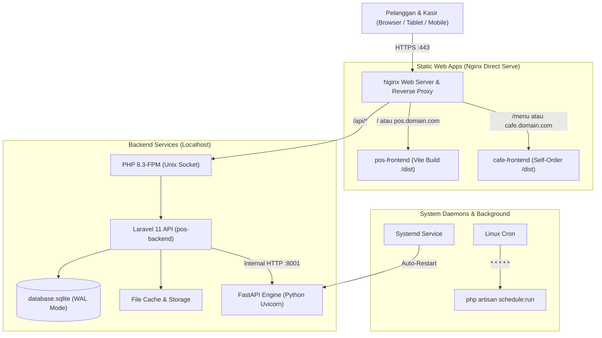

# Panduan Lengkap Instalasi & Deployment di Linux VPS (Ubuntu)
## Arunika F&B POS Suite (SQLite Ultra-Lightweight & Production-Ready)

Panduan ini dirancang khusus untuk mendeploy **Arunika POS Suite** pada **Linux VPS (Ubuntu 22.04 / 24.04 LTS)** dengan spesifikasi hemat biaya (**1 vCPU, 1 GB – 2 GB RAM**) menggunakan arsitektur **SQLite (WAL Mode)**, **Nginx**, **PHP-FPM dengan OPcache**, dan **Python FastAPI Microservice (Systemd Daemon)**.

---

## 1. Arsitektur Deployment di VPS



---

## 2. Persiapan Server & Paket Sistem (Ubuntu)

Login ke VPS Anda via SSH sebagai `root`:

```bash
ssh root@IP_VPS_ANDA
```

### Langkah 2.1: Update Repository & Paket Dasar
```bash
sudo apt update && sudo apt upgrade -y
sudo apt install -y curl wget git unzip zip software-properties-common ufw
```

### Langkah 2.2: Setup Swap Memory (Sangat Krusial untuk VPS 1GB RAM)
Swap mencegah server mengalami *Out-Of-Memory (OOM)* saat menjalankan `composer install` atau `npm build`:
```bash
# Buat file swap 2GB
sudo fallocate -l 2G /swapfile
sudo chmod 600 /swapfile
sudo mkswap /swapfile
sudo swapon /swapfile

# Buat permanen saat server restart
echo '/swapfile none swap sw 0 0' | sudo tee -a /etc/fstab
```

---

## 3. Instalasi PHP 8.3 & Ekstensi yang Dibutuhkan

```bash
# Tambahkan PPA PHP Sury
sudo add-apt-repository ppa:ondrej/php -y
sudo apt update

# Install PHP-FPM dan ekstensi yang wajib untuk Arunika POS
sudo apt install -y php8.3-fpm php8.3-cli php8.3-sqlite3 php8.3-gd \
    php8.3-curl php8.3-mbstring php8.3-xml php8.3-zip php8.3-bcmath \
    php8.3-opcache
```

### Optimasi PHP-FPM & OPcache untuk Low RAM:
Buka berkas konfigurasi pool FPM:
```bash
sudo nano /etc/php/8.3/fpm/pool.d/www.conf
```
Sesuaikan nilai berikut agar worker tidak boros RAM:
```ini
pm = ondemand
pm.max_children = 10
pm.process_idle_timeout = 15s;
pm.max_requests = 500
```

Buka konfigurasi OPcache:
```bash
sudo nano /etc/php/8.3/fpm/conf.d/10-opcache.ini
```
Tambahkan konfigurasi berikut untuk memangkas penggunaan CPU:
```ini
opcache.enable=1
opcache.memory_consumption=64
opcache.interned_strings_buffer=8
opcache.max_accelerated_files=10000
opcache.revalidate_freq=0
opcache.validate_timestamps=1
opcache.save_comments=1
```

Restart PHP-FPM:
```bash
sudo systemctl restart php8.3-fpm
sudo systemctl enable php8.3-fpm
```

### Install Composer:
```bash
curl -sS https://getcomposer.org/installer | php
sudo mv composer.phar /usr/local/bin/composer
```

---

## 4. Instalasi Python & Node.js

### Langkah 4.1: Python 3 & Pip (Untuk Forecasting Engine)
```bash
sudo apt install -y python3 python3-pip python3-venv
```

### Langkah 4.2: Node.js 20 LTS (Untuk Build Frontend)
```bash
curl -fsSL https://deb.nodesource.com/setup_20.x | sudo -E bash -
sudo apt install -y nodejs
```

---

## 5. Clone Proyek & Setup Direktori Web

```bash
# Buat direktori aplikasi
sudo mkdir -p /var/www/pos
sudo chown -R $USER:$USER /var/www/pos

# Clone repository proyek Anda
git clone <URL_REPOSITORY_ANDA> /var/www/pos
cd /var/www/pos
```

---

## 6. Setup Backend Laravel (`pos-backend`)

### Langkah 6.1: Instal Dependensi PHP
```bash
cd /var/www/pos/pos-backend
composer install --no-dev --optimize-autoloader
```

### Langkah 6.2: Konfigurasi Berkas `.env`
Salin dan edit `.env`:
```bash
cp .env.example .env
nano .env
```
Pastikan pengaturan berikut terpasang (hemat RAM & stabil di SQLite):
```ini
APP_NAME="Arunika POS"
APP_ENV=production
APP_KEY=
APP_DEBUG=false
APP_URL=https://pos.domainanda.com

LOG_CHANNEL=daily
LOG_LEVEL=error

# Database SQLite dengan WAL Mode
DB_CONNECTION=sqlite
DB_JOURNAL_MODE=WAL
DB_SYNCHRONOUS=NORMAL
DB_BUSY_TIMEOUT=10000

# Cache & Session menggunakan File (Hemat 0 MB RAM)
SESSION_DRIVER=file
CACHE_STORE=file
QUEUE_CONNECTION=database

# URL Forecasting Microservice lokal
FORECASTING_SERVICE_URL=http://127.0.0.1:8001
```

Generate App Key:
```bash
php artisan key:generate
```

### Langkah 6.3: Inisialisasi Database SQLite & Migrasi
```bash
# Buat file database jika belum ada
touch database/database.sqlite

# Jalankan migrasi dan seeder
php artisan migrate --force --seed
```

### Langkah 6.4: Storage Link & Hak Akses Berkas
```bash
# Buat symlink storage publik
php artisan storage:link

# Berikan izin ke user www-data (Nginx & PHP-FPM)
sudo chown -R www-data:www-data /var/www/pos/pos-backend/storage
sudo chown -R www-data:www-data /var/www/pos/pos-backend/bootstrap/cache
sudo chown -R www-data:www-data /var/www/pos/pos-backend/database
sudo chown -R www-data:www-data /var/www/pos/pos-backend/public/uploads

sudo chmod -R 775 /var/www/pos/pos-backend/storage
sudo chmod -R 775 /var/www/pos/pos-backend/bootstrap/cache
sudo chmod -R 775 /var/www/pos/pos-backend/database
sudo chmod -R 775 /var/www/pos/pos-backend/public/uploads
```

### Langkah 6.5: Cache Konfigurasi & Routing Produksi
```bash
php artisan config:cache
php artisan route:cache
php artisan view:cache
```

---

## 7. Setup Forecasting Engine (FastAPI Microservice)

### Langkah 7.1: Virtualenv & Install Dependensi
```bash
cd /var/www/pos/forecasting-engine
python3 -m venv venv
source venv/bin/activate
pip install --upgrade pip
pip install -r requirements.txt
deactivate
```

### Langkah 7.2: Buat Systemd Service Daemon
Agar Python Uvicorn otomatis berjalan saat VPS dinyalakan dan otomatis *restart* jika ada error:
```bash
sudo nano /etc/systemd/system/arunika-forecasting.service
```
Tempelkan konfigurasi berikut:
```ini
[Unit]
Description=Arunika Forecasting Engine Microservice
After=network.target

[Service]
Type=simple
User=www-data
Group=www-data
WorkingDirectory=/var/www/pos/forecasting-engine
ExecStart=/var/www/pos/forecasting-engine/venv/bin/uvicorn main:app --host 127.0.0.1 --port 8001 --workers 1 --limit-concurrency 50 --no-access-log
Restart=always
RestartSec=5
KillMode=process
StandardOutput=syslog
StandardError=syslog
SyslogIdentifier=arunika-forecast

[Install]
WantedBy=multi-user.target
```

Nyalakan dan aktifkan service:
```bash
sudo systemctl daemon-reload
sudo systemctl start arunika-forecasting
sudo systemctl enable arunika-forecasting

# Cek status service (harus active running)
sudo systemctl status arunika-forecasting
```

---

## 8. Build Frontend (`pos-frontend` & `cafe-frontend`)

### Langkah 8.1: Build Kasir & Admin (`pos-frontend`)
```bash
cd /var/www/pos/pos-frontend
npm install
npm run build
```
Hasil build akan tersimpan di `/var/www/pos/pos-frontend/dist`.

### Langkah 8.2: Build Self-Order Tamu (`cafe-frontend`)
```bash
cd /var/www/pos/cafe-frontend
npm install
npm run build
```
Hasil build akan tersimpan di `/var/www/pos/cafe-frontend/dist`.

---

## 9. Konfigurasi Web Server Nginx

Install Nginx:
```bash
sudo apt install -y nginx
```

Buat konfigurasi situs Nginx untuk aplikasi Arunika POS:
```bash
sudo nano /etc/nginx/sites-available/arunika-pos.conf
```

Tempel konfigurasi produksi berikut (sudah dilengkapi proteksi SSE non-buffering, batas upload 15MB, dan Gzip compression):

```nginx
# Konfigurasi Gzip Compression (Hemat Bandwidth & CPU)
gzip on;
gzip_types text/plain text/css application/json application/javascript text/xml application/xml application/xml+rss text/javascript image/svg+xml;
gzip_min_length 1024;
gzip_vary on;

server {
    listen 80;
    server_name pos.domainanda.com; # Ganti dengan domain/subdomain Anda

    root /var/www/pos/pos-frontend/dist;
    index index.html;

    client_max_body_size 15M;

    # 1. Frontend POS Kasir & Dashboard Admin
    location / {
        try_files $uri $uri/ /index.html;
    }

    # 2. Uploads Foto Menu Produk
    location /uploads/ {
        alias /var/www/pos/pos-backend/public/uploads/;
        expires 30d;
        add_header Cache-Control "public, no-transform";
        try_files $uri =404;
    }

    # 3. Server-Sent Events (SSE) Stream - WAJIB NON-BUFFERING
    location /api/orders/stream {
        proxy_pass http://unix:/run/php/php8.3-fpm.sock:;
        include fastcgi_params;
        fastcgi_pass unix:/run/php/php8.3-fpm.sock;
        fastcgi_param SCRIPT_FILENAME /var/www/pos/pos-backend/public/index.php;
        
        # Non-buffering agar event SSE terkirim instan ke browser
        fastcgi_buffering off;
        fastcgi_cache off;
        fastcgi_read_timeout 60s;
        proxy_buffering off;
        proxy_cache off;
        proxy_set_header Connection '';
        chunked_transfer_encoding off;
    }

    # 4. Backend Laravel API
    location /api {
        alias /var/www/pos/pos-backend/public;
        try_files $uri $uri/ @laravel;

        location ~ \.php$ {
            include fastcgi_params;
            fastcgi_pass unix:/run/php/php8.3-fpm.sock;
            fastcgi_param SCRIPT_FILENAME /var/www/pos/pos-backend/public/index.php;
            fastcgi_read_timeout 60s;
        }
    }

    location @laravel {
        rewrite /api/(.*)$ /api/index.php?/$1 last;
    }

    # Block akses berkas sensitif (.env, .git, .sqlite)
    location ~ /\.(?!well-known).* {
        deny all;
    }
    location ~* \.sqlite$ {
        deny all;
    }
}
```

Aktifkan konfigurasi dan uji sintaks:
```bash
sudo ln -s /etc/nginx/sites-available/arunika-pos.conf /etc/nginx/sites-enabled/
sudo nginx -t
sudo systemctl reload nginx
```

---

## 10. Pasang SSL Gratis (HTTPS) dengan Certbot

```bash
sudo apt install -y certbot python3-certbot-nginx
sudo certbot --nginx -d pos.domainanda.com
```
Certbot akan otomatis memperbarui sertifikat SSL sebelum kedaluwarsa.

---

## 11. Konfigurasi Linux Cron (Laravel Scheduler)

Laravel memiliki 4 tugas otomatis harian (snapshot peramalan, laporan digest pagi ke owner, backup SQLite harian, dan pruning log):

Buka crontab:
```bash
sudo crontab -e -u www-data
```
Tambahkan satu baris berikut di baris paling bawah:
```cron
* * * * * cd /var/www/pos/pos-backend && php artisan schedule:run >> /dev/null 2>&1
```

---

## 12. Firewall & Keamanan Dasar

```bash
# Buka port SSH, HTTP, dan HTTPS
sudo ufw allow OpenSSH
sudo ufw allow 'Nginx Full'

# Aktifkan Firewall
sudo ufw enable
```

---

## 13. Perintah Pemeliharaan & Troubleshooting

| Kebutuhan | Perintah di Terminal VPS |
| :--- | :--- |
| **Cek Status Python AI Engine** | `sudo systemctl status arunika-forecasting` |
| **Restart Python AI Engine** | `sudo systemctl restart arunika-forecasting` |
| **Restart PHP & Bersihkan Cache** | `sudo systemctl restart php8.3-fpm && cd /var/www/pos/pos-backend && php artisan optimize:clear && php artisan optimize` |
| **Lihat Log Eror Backend** | `tail -f /var/www/pos/pos-backend/storage/logs/laravel-*.log` |
| **Lihat Log Eror Nginx** | `tail -f /var/log/nginx/error.log` |
| **Backup Manual Database SQLite** | `cp /var/www/pos/pos-backend/database/database.sqlite /var/backups/db_backup_$(date +%F).sqlite` |

---

### Selesai!
Arunika POS Suite Anda kini berjalan aktif di VPS secara aman, terisolasi, super cepat, dan menggunakan **kurang dari 200MB RAM**.
