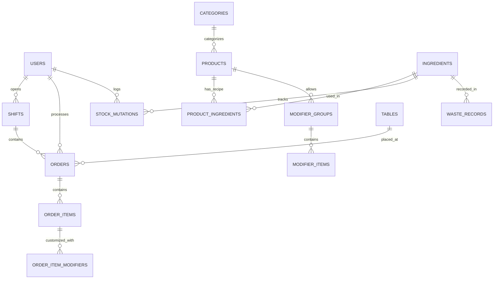

# 📌 Arsitektur & Model Domain POS Suite

Dokumen ini menjelaskan model domain, entitas basis data, service layer, dan alur bisnis utama pada ekosistem Point of Sale (POS) dan F&B Inventory Management.

---

## 1. Domain Entities & Database Model

Sistem mengadopsi skema database relasional terstruktur:

### Entitas Utama:
1. **User (`users`)**:
   - Multi-role: `superadmin` (Owner), `admin` (Manajer/Gudang), `cashier` (Kasir), `kitchen` (Staf Dapur).
2. **Katalog & Modifiers (`categories`, `products`, `modifier_groups`, `modifier_items`)**:
   - Mendukung SKU, barcode, harga jual, dan HPP (`cost_price`).
   - Mendukung opsi varian berbayar/gratis (misal: *Less Sugar*, *Large Cup*, *Extra Shot*).
3. **Resep & Bahan Mentah (`ingredients`, `product_ingredients`)**:
   - Model Bill of Materials (BOM). Menyimpan rasio takaran per porsi menu dan rasio konversi unit (misal: kg ke gram).
4. **Audit Mutasi & Waste (`stock_mutations`, `waste_records`)**:
   - Menjamin akuntabilitas. Segala perubahan stok barang jadi maupun bahan mentah tercatat audit trail (*User ID, tipe: in/out/sales/void/opname, stok sebelum, stok sesudah*).
5. **Transaksi & Shift (`orders`, `order_items`, `shifts`, `held_orders`)**:
   - Pencatatan transaksi real-time terisolasi per shift kasir aktif.

---

## 2. Service Layer Pattern (Backend Architecture)

Semua kalkulasi moneter dan mutasi persediaan diisolasi dalam Service Layer di [pos-backend/app/Services](file:///c:/Users/lenov/Documents/POS/pos-backend/app/Services):

### A. `InventoryService`
- **Tanggung Jawab:**
  - Mengelola mutasi stok produk jadi dan bahan baku mentah.
  - Pengurangan bahan baku otomatis saat pesanan dibuat (`deductIngredientsForOrder`).
  - Pengembalian bahan baku otomatis saat pesanan di-void/dibatalkan (`restoreIngredientsForOrder`).
  - Pemotongan stok saat pencatatan bahan terbuang/basi (`recordWaste`).
  - Pencatatan kartu mutasi stok (`StockMutation`) untuk setiap event inventaris.

### B. `OrderPricingService`
- **Tanggung Jawab:**
  - Menghitung subtotal item dan total modifier.
  - Kalkulasi diskon berjenjang (persentase `%` maupun potongan nominal `Rp`).
  - Kalkulasi pajak PPN dinamis (server-side, mencegah manipulasi harga dari client).
  - Validasi nominal pembayaran dan kalkulasi uang kembalian (*change*).

### C. `ReconciliationService`
- **Tanggung Jawab:**
  - Menghitung stok teoritis/ekspektasi sistem matematis:
    $$\text{Expected Stock} = \text{Stok Awal} + \text{Masuk} - \text{Terpakai Penjualan} - \text{Waste} \pm \text{Koreksi}$$
  - Membandingkan stok riil fisik dengan stok sistem.
  - Deteksi anomali otomatis (*Auto-flagging anomaly*) apabila deviasi selisih melebihi batas toleransi (> 5%).

### D. `ReportService`
- **Tanggung Jawab:**
  - Agregasi penjualan harian, mingguan, dan bulanan.
  - Perhitungan Laba Kotor (*Gross Profit* = Omzet Bersih - HPP).
  - Evaluasi performa omzet kasir per shift.
  - Pembuatan laporan ekspor berformat CSV.
